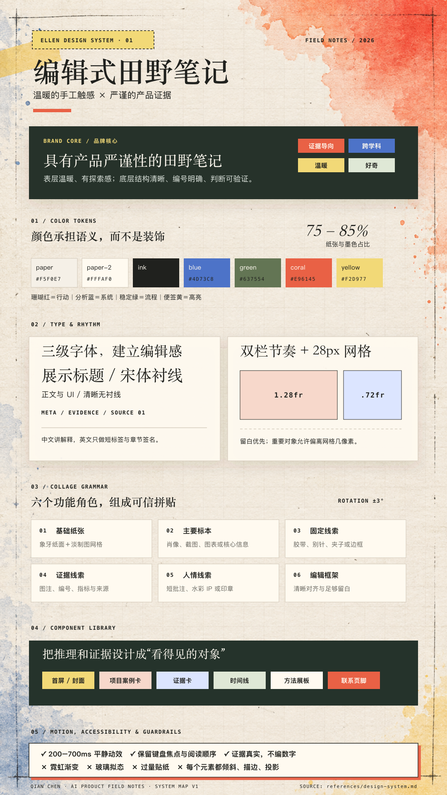
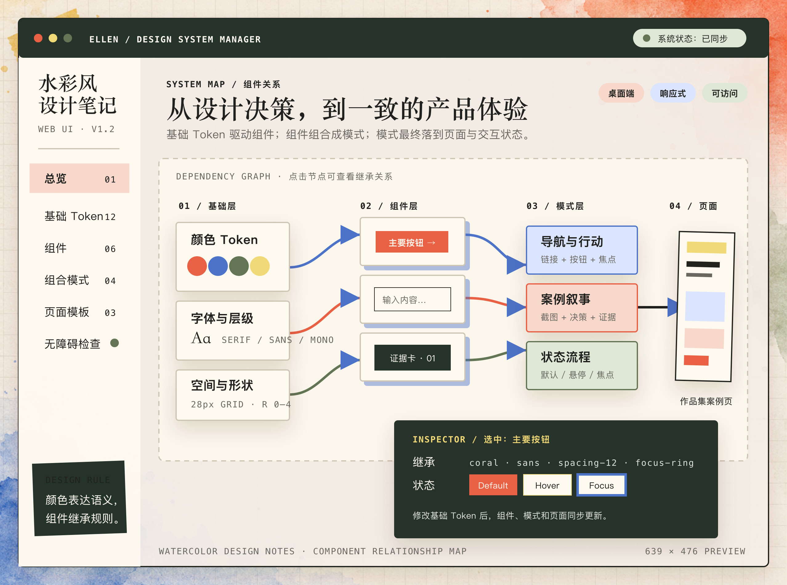

# Ellen Design System

一套面向个人作品集、项目汇报、社交媒体视觉和产品原型的中文 Codex Skill。

它将编辑式信息层级、产品证据和水彩纸张触感组合成稳定的个人品牌语言：温暖但不松散，具有手工感但保持产品设计的严谨性。



## 能做什么

- 将网站、PPT、文档、海报和社交媒体视觉统一为 Ellen 风格。
- 使用语义化色彩、字体层级、网格、组件和拼贴规则完成新作品。
- 审核现有设计与本系统的符合程度，并给出可执行的修改建议。
- 根据输入内容、受众、媒介和输出格式生成适合复用的设计 Brief。

## 设计系统内容

- 13 个语义色彩 Token
- 展示字体、正文、元数据和短批注四类字体角色
- 28 px 网格、双栏比例、边框、阴影和旋转规则
- 导航、首屏、案例卡、方法展板、证据卡、时间线和页脚模式
- 基础 Token → 组件 → 组合模式 → 页面之间的继承关系
- 动效、响应式、无障碍和内容真实性约束



## 安装

将仓库克隆或复制到 Codex Skills 目录：

```bash
git clone https://github.com/chenqian1999-410/ellen-design-system.git ~/.codex/skills/ellen-design-system
```

之后在任务中调用：

```text
使用 $ellen-design-system，把以下内容制作成一张 1080×1440 的社交媒体长图。

受众：关注产品设计的人
传播目标：让读者在 10 秒内理解核心观点
风格强度：强拼贴版
主色：珊瑚红
要求：缩略图下标题清晰，不要堆叠过多贴纸

内容：
[粘贴内容]
```

更多输入、输出和可复制提示词见 [`references/usage-and-prompts.md`](references/usage-and-prompts.md)。

## 文件结构

```text
ellen-design-system/
├── SKILL.md
├── agents/openai.yaml
├── references/
│   ├── design-system.md
│   ├── adaptation-guide.md
│   └── usage-and-prompts.md
└── assets/
    ├── ellen-tokens.css
    ├── ellen-mark.svg
    ├── ellen-design-system-overview.png
    ├── ellen-component-relationship-map-hd.png
    └── ...
```

## 身份资产说明

`chenchen-*` 人物图像是 Ellen 的个人身份资产。公开仓库用于展示和复用 Ellen 自己的视觉系统；不要将这些人物资产替换进第三方品牌或冒充其他身份。

## 来源

本设计系统基于 Ellen 的 AI 产品经理作品集提取、整理与扩展。
